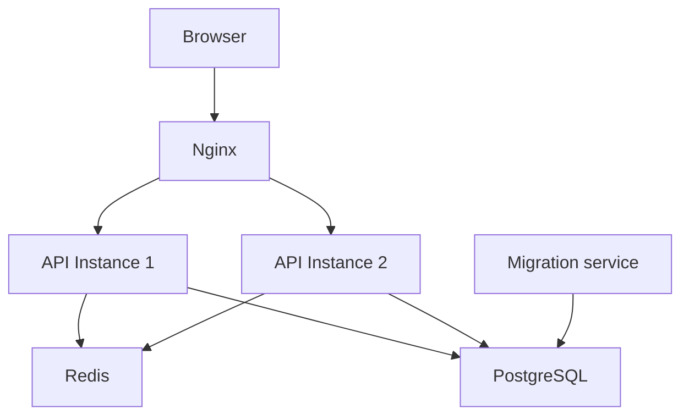
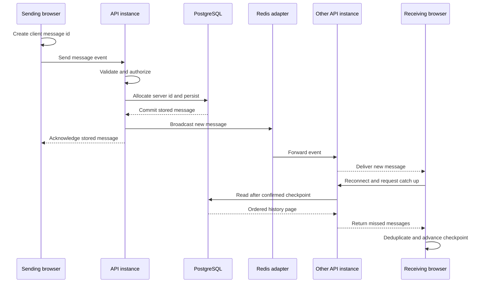

# Relay Chat

Relay Chat is a real-time messaging application focused on keeping chat history
consistent when connections fail and users connect through different API
instances. It demonstrates durable message storage, reconnect recovery,
distributed sessions and presence, server-side security controls, automated
testing, and a reproducible Docker deployment. The interesting problem is the
boundary between a committed database write and a live event that may arrive
late, arrive twice, or never reach a disconnected browser.

**Release status:** preparation for `v1.0.0`; this README does not assert that a
GitHub release, registry image or public deployment has been published. See the
[release checklist](docs/release.md) for outstanding verification.

## Visual overview

> Screenshot placeholder: add a real capture of the chat screen showing two users,
> channel membership and message states. No screenshot is included yet.

> Optional demo placeholder: record a short send, disconnect and reconnect journey.
> No demonstration GIF is included yet.

## Features

- **Authentication:** register, log in, log out and restore identity through
  Redis-backed cookie sessions, with Argon2id passwords and normalized emails.
- **Channels:** public/private channels, server-enforced membership, join/leave,
  unread counts, mark-as-read and cursor-paginated message history. Private
  channels return 404 to non-members.
- **Live chat:** validated Socket.IO events, optimistic messages with pending,
  failed and retry states, typing indicators and multi-tab presence.
- **Recovery:** queued offline sends, acknowledgement deadlines, stable client
  message IDs, deduplication and paginated reconnect catch-up.
- **Browser UI:** light/dark themes with a pre-paint bootstrap, virtualized upward
  history loading, keyboard-accessible controls and safe plain-text rendering
  with HTTP/HTTPS autolinks.
- **Distributed coordination:** two API replicas share Redis sessions, rate
  limits, presence leases and Socket.IO fanout; PostgreSQL stores durable data.
- **Security:** exact Origin allowlists, CSRF checks, current server-side
  authorization, bounded inputs, flood controls and regression tests for XSS,
  session tampering and unauthorized sockets.

The API supports channel creation; the current chat UI does not provide a
channel-creation form. Some member labels are generic rather than display names.

## Technology stack

| Technology                                 | Purpose                                                            |
| ------------------------------------------ | ------------------------------------------------------------------ |
| Node 24, npm workspaces, strict TypeScript | One monorepo with API, browser and shared packages                 |
| Express 5, Socket.IO                       | REST endpoints and acknowledged real-time events                   |
| PostgreSQL 17, Drizzle, node-postgres      | Durable messages, relational constraints and migrations            |
| Redis 8 and Socket.IO Redis adapter        | Sessions, shared limits, presence leases and cross-instance events |
| Zod, Argon2id                              | Boundary validation and password hashing                           |
| React, Vite, React Router                  | Browser application, routing and local proxy                       |
| TanStack Query, React Hook Form, Tailwind  | Server-state caching, validated forms and styling                  |
| Docker Compose, Nginx                      | Reproducible services, ingress and browser security headers        |
| Vitest, Testing Library, MSW, Playwright   | Unit, component, integration and browser checks                    |
| k6                                         | Opt-in authenticated multi-instance delivery measurements          |
| GitHub Actions and GHCR                    | Automated checks, manual real-stack E2E and gated versioned images |

## Architecture



Nginx serves the built web app and forwards REST and WebSocket traffic to either
API replica. Only Nginx publishes a host port in the production-style Compose
stack; the APIs and data services stay on an internal network. The one-shot
migration must complete before either API becomes available.

PostgreSQL is the source of truth for users, channels, memberships, read markers
and messages. Redis holds shared session and coordination state, not durable chat
history. Each WebSocket stays on one API connection; the Redis adapter reaches
clients on the other replica. WebSocket-only transport avoids the request
routing affinity that Socket.IO long-polling would require. Two replicas on one
Compose host are a coordination demonstration, not a high-availability guarantee.

Source layout: [`apps/api`](apps/api), [`apps/web`](apps/web),
[`packages/shared`](packages/shared), and [Docker deployment notes](docs/docker.md).

## Message delivery and reconnect



The browser's `client_message_id` identifies a send attempt across retries. It is
different from the server's time-sortable ULID. The API validates the session,
current user state, payload and channel membership before writing. A transaction
holds a global advisory lock while allocating the next message ID and committing
the insert, so cursor order follows commit order across replicas.

The database's unique `(user_id, client_message_id)` constraint makes retries
idempotent. A repeated ID returns the stored message; only a new insert triggers
a broadcast. Persistence finishes before broadcast and acknowledgement. The order
in which browsers receive live events and acknowledgements is not guaranteed.

On reconnect, the shared reliability module requests ordered pages after each
channel's **confirmed catch-up checkpoint**. Live events alone do not advance it,
because pub/sub events can arrive out of order. The server joins the live room
before reading the history snapshot; the client deduplicates overlapping results
by message ID and user/client-message ID. Offline and unacknowledged sends reuse
the original client ID. Exhausted attempts surface a failed state and an explicit
retry action.

This is application-level duplicate prevention and recovery, **not exactly-once
network delivery**. A write can commit while its acknowledgement or broadcast is
lost. Redis pub/sub does not replay missed events; catch-up reads PostgreSQL.
Queues and checkpoints live in browser memory, so they do not survive a full page
reload. Presence counts expiring connection leases: closing one tab leaves a user
online if another tab is connected, and crashed instances eventually expire.

See the [event contract](docs/events.md) and
[framework-independent reliability module](packages/shared/src/reliable-client.ts).

## Security

Session cookies are HttpOnly, host-only and SameSite=Lax, with Secure enabled in
production. The cookie contains an opaque random identifier; session data lives
in Redis. Login rotates the identifier and invalidates the old session, logout
revokes it server-side, and a sliding idle lifetime is capped by an absolute
maximum. Roles, bans and membership are read on the server rather than trusted
from a cookie.

State-changing REST requests require both the custom CSRF header and an exact
allowed Origin. Socket handshakes require an allowed Origin and a valid session;
events recheck authorization, and removed members are pruned before delivery.
Redis-backed HTTP, authentication, handshake and per-user limits span replicas;
per-socket limits additionally bound individual connections. Zod schemas and
transport/body limits constrain inputs before application work.

React renders message bodies and display names as text. Autolinks accept only
HTTP/HTTPS without embedded credentials and use `noopener noreferrer`. Browser
regressions check literal XSS payloads, the absence of injected elements and
dialogs, and rendering after reload. Non-root API/Nginx images, private services,
read-only application filesystems, Nginx security headers and a hash-based theme
CSP add deployment controls. Scripts receive no `unsafe-inline` permission.

Redis sessions make revocation and expiry straightforward and keep identity data
out of browser-managed tokens. The trade-off is a Redis lookup and dependency on
Redis availability. Browser-stored JWTs could reduce session-store reads but
would introduce token storage and revocation decisions; they would not remove
the need for current authorization checks.

The local Docker stack is HTTP. Production Secure cookies and public deployment
require a reviewed HTTPS ingress; do not weaken cookie flags to deploy it. Dev
servers must remain loopback-only. See [SECURITY.md](SECURITY.md) for controls,
tests, current audit status and limitations. This project does not claim security
certification or a comprehensive penetration test.

## Setup and development

### A. Normal local development

Prerequisites: Node 24 from [`.nvmrc`](.nvmrc), npm 11, PostgreSQL 17, Redis 8,
and Docker Compose v2 if using the supplied data-service setup. WSL2 Ubuntu is
the documented local environment.

From the repository root:

```bash
nvm use
npm ci --ignore-scripts
```

This uses the lockfile and bundled native prebuilds, as the Dockerfiles do,
without approving lifecycle scripts automatically.

For a new checkout only, copy the example if no local environment file exists:

```bash
test -e .env || cp .env.example .env
```

Privately configure the existing example's `POSTGRES_USER`, `POSTGRES_PASSWORD`,
`DATABASE_URL`, `DATABASE_URL_TEST`, `REDIS_URL` and `SESSION_SECRET`. Keep database
credentials consistent, URL-encode reserved characters in connection URLs, and
use a generated session secret. Keep `NODE_ENV=development` and the existing
loopback Origin allowlist. Never commit these values. Startup validation reports
invalid field names without printing their values.

Start the development data services yourself, then migrate and start the apps:

```bash
docker compose up -d --wait
npm run build --workspace=@relay-chat/shared
npm run db:migrate --workspace=@relay-chat/api
npm run dev
```

Vite listens on `http://127.0.0.1:5173` and proxies `/api` and `/socket.io` to the
API on loopback port 3000, keeping browser requests on one origin. The shared
workspace must be rebuilt after changing its exported source. Existing database
volumes retain their original passwords; editing the environment does not rotate
a previously initialized PostgreSQL role.

Create the dedicated integration database once if it does not already exist:

```bash
docker compose exec postgres sh -c 'createdb -U "$POSTGRES_USER" relay_chat_test'
npm run db:migrate:test --workspace=@relay-chat/api
```

Set `DATABASE_URL_TEST` to that database, never the development database. For
browser tests create a separate E2E database as described in
[testing instructions](docs/testing.md). These creation commands do not drop or
replace databases; an existing-database error means you should inspect its purpose.

### B. Production-style Docker testing

Use the standalone `compose.production.yml` stack, which has its own project,
volumes, migration service, two API replicas and Nginx. Do not overlay it on the
development Compose file. Follow [docs/docker.md](docs/docker.md) for configuration,
image builds, health checks, startup and verification. Both local browser origins
are explicitly supported at the configured port; external HTTP origins are not.
This is a local deployment exercise, not evidence of a public production service.

## Testing and quality

| Check                    | Command                                                            | What it verifies                                                                      |
| ------------------------ | ------------------------------------------------------------------ | ------------------------------------------------------------------------------------- |
| Formatting               | `npm run format:check`                                             | Repository style                                                                      |
| Typecheck                | `npm run typecheck`                                                | Workspace and E2E TypeScript contracts                                                |
| Lint                     | `npm run lint`                                                     | Static, React hooks and accessibility rules                                           |
| Unit and component tests | `npm test`                                                         | Shared reliability, API controls, UI behavior and Docker configuration tests          |
| Integration              | `npm run test:integration`                                         | Real PostgreSQL/Redis constraints, sessions, authorization and cross-instance sockets |
| Coverage                 | `npm run test:coverage`                                            | Existing independent 80% line threshold per workspace                                 |
| Browser E2E              | `npm run test:e2e`                                                 | Two isolated users, live chat, typing, reconnect, XSS and HttpOnly sessions           |
| Application build        | `npm run build`                                                    | Compiled API/shared packages and browser production bundle                            |
| Docker smoke             | `node --env-file-if-exists=.env scripts/docker/compose.mjs verify` | Running stack health, HTTP policy and WebSocket routing                               |
| Load harness tests       | `node --test scripts/load/*.test.mjs`                              | Protocol framing, measurement and loss-accounting logic                               |
| Production audit         | `npm audit --omit=dev --audit-level=high`                          | High/critical runtime dependency findings                                             |
| Full audit               | `npm audit`                                                        | All dependency findings, including development tooling                                |

Integration and API coverage require existing PostgreSQL/Redis services and a
dedicated test database. E2E additionally requires Chromium; its setup and
independently runnable scenarios are in [docs/testing.md](docs/testing.md).
The recovered [per-file report](docs/coverage.md) records **shared 96.77%, API
92.51% and web 91.26% lines**, each above the existing 80% threshold. These verified
report figures are preserved; fresh command results are recorded separately in
[release validation](docs/release.md#validation-record). Coverage is evidence of
executed code, not proof of correctness. Do not raise timeouts,
skip tests or relax thresholds to make a run pass.

Current release-preparation results are recorded in
[the release validation record](docs/release.md#validation-record), rather than
presenting historical counts as current proof.

## Performance and load tests

The checked-in [increasing-load campaign](scripts/load/increasing-load.json) from
28 October 2026 used an Intel i5-10210U with eight logical CPUs, approximately
3.6 GiB allocated to WSL, two API processes and k6 on the same machine. It sent
one message per second per connection for 20 seconds, with up to eight members
per channel. The recorded free-memory snapshot was about 1.48 GiB.

| Connections | Channels | Delivery p95 | Active samples waiting on advisory lock |
| ----------: | -------: | -----------: | --------------------------------------: |
|           2 |        1 |       134 ms |                                      0% |
|           8 |        1 |       110 ms |                                     11% |
|          16 |        2 |       248 ms |                                     43% |
|          32 |        4 |       206 ms |                                     64% |
|          64 |        8 |      5141 ms |                                     96% |

These are rounded historical results, not a supported capacity limit. The
64-connection stage failed the 500 ms p95 threshold and did not reproduce
consistently. The detailed report also retains a four-connection stage and an
earlier eight-connection result of 812 ms, rather than discarding failed runs.

A separate operator-labelled 64-connection diagnostic comparison recorded p95s
of **36, 251 and 379 ms** with synchronous commit on, median **251 ms**, and
**19, 28 and 40 ms** with it off, median **28 ms**. The campaign and summarized
diagnostic runs reconciled with no lost or duplicate deliveries. This measures
those runs only; it does not establish crash durability or a maximum user count.

The source shows a global PostgreSQL advisory lock serializing message ID
allocation and commit order. Its contention grows across unrelated channels.
A proposed per-channel lock could reduce that contention, but it is **not
implemented**: the measurements are variable, and changing the lock would alter
core ordering guarantees. Synchronous commit remains enabled. Turning it off
was diagnostic only and was rejected as a production optimization because a
crash could lose messages whose commits had already been acknowledged.

See the [load report](scripts/load/README.md) for workload, thresholds,
instrumentation, preserved diagnostic evidence and caveats. No new load campaign
was run for this documentation change.

## CI and releases

[Automatic CI](.github/workflows/ci.yml) runs for pull requests targeting `main`,
pushes to `main` and version tags matching `v*`. It uses Node from `.nvmrc`, locked
installs, real PostgreSQL/Redis services and a dedicated CI database. Migrations
precede integration tests. Formatting, lint, typecheck, unit/integration tests,
coverage, builds, Docker configuration and CI/load-harness tests are required.
The production high/critical dependency audit blocks CI; full audit findings
remain visible in a separate reporting-only step.

[Manual Docker E2E](.github/workflows/e2e.yml) runs only through
`workflow_dispatch`, separate from automatic checks. It builds an isolated
Compose project, waits for health, verifies migrations and HTTP/WebSocket routing,
runs Chromium journeys through Nginx and cleans up its ephemeral resources even
after failure.

Version-tag pushes publish separate API and web images **only after required CI
checks pass**. Only the publishing job has `packages: write`; authentication uses
`GITHUB_TOKEN`. Feature branches and pull requests do not publish. Images use the
exact Git tag and OCI source, version and description metadata. There is no
mutable `latest` alias. See [CI documentation](docs/ci.md) for permissions,
service isolation, action pins, artifacts and manual dispatch instructions.
Do not infer successful hosted execution or publication from local checks.

The repository owner was verified from local project configuration as
`SiyaCodesStuff`; the intended package names for `v1.0.0` are:

```text
ghcr.io/siyacodesstuff/relay-chat-api:v1.0.0
ghcr.io/siyacodesstuff/relay-chat-web:v1.0.0
```

These are naming targets, not claims that packages exist. The web image's CSP
uses build-time `PUBLIC_ORIGIN`; set the intended exact HTTPS origin before a
public deployment build. GHCR packages may need their visibility changed to
public after the first publication. No badge, deployed URL or release is claimed.

## Design Decisions and Trade-offs

| Decision                                      | Benefit and limitation                                                                                                         |
| --------------------------------------------- | ------------------------------------------------------------------------------------------------------------------------------ |
| Redis sessions instead of browser-stored JWTs | Central revocation and expiry; requires shared Redis availability and lookups                                                  |
| Socket.IO instead of raw WebSockets           | Acknowledgements, rooms and reconnect support; protocol/client dependencies and explicit application recovery remain necessary |
| PostgreSQL for messages                       | Transactions, durable records and relational constraints; write latency and contention affect delivery                         |
| Redis for coordination                        | Shared limits, expiring presence and replica fanout; pub/sub is not durable message history                                    |
| Idempotent client message IDs                 | Safe resend after ambiguous acknowledgements; clients must retain the same ID                                                  |
| Persist before broadcast                      | Reconnect can recover a committed message; no atomic transaction spans PostgreSQL and pub/sub                                  |
| Strict server-side authorization              | Current sessions, bans and memberships govern actions and recipients; adds database/Redis work                                 |
| Multi-stage Docker images                     | Separates build tooling from API runtime dependencies; image builds and native compatibility still need validation             |
| Two APIs behind Nginx                         | Exercises real shared state and fanout; a single host, PostgreSQL and Redis remain failure domains                             |
| Automated tests and CI                        | Repeatable regressions and release gates; test coverage and local success do not establish production behavior                 |
| Synchronous PostgreSQL commits                | Retains normal WAL durability at acknowledgement; commit latency is part of the send path                                      |

## Known limitations

- The global advisory lock serializes writes across channels. Per-channel locking
  remains a proposal, not a delivered optimization.
- Capacity and a production SLA are unverified. Short, variable laptop tests with
  a colocated generator cannot establish internet-scale throughput or availability.
- There is no verified public deployment. Supplied Compose is loopback HTTP;
  public TLS, backups, restore drills and infrastructure failover require review.
- Offline queues are in memory and do not survive page reload. Redis pub/sub
  delivery is transient; PostgreSQL catch-up is the recovery mechanism.
- The UI lacks a channel-creation form and uses generic member labels in places.
- Development dependency advisories and any current audit blockers are listed in
  [SECURITY.md](SECURITY.md). Do not apply automatic breaking downgrades as a fix.
- Release approval still requires successful checks for the final release commit,
  including hosted CI and the manual real-stack E2E workflow. Workflow presence
  and local tests do not establish those hosted results.

## Documentation and licence

- [Security controls and known issues](SECURITY.md)
- [Docker topology and operations](docs/docker.md)
- [Socket event contract](docs/events.md)
- [Testing and coverage](docs/testing.md)
- [Web behavior and development notes](docs/web.md)
- [CI and image publishing](docs/ci.md)
- [Load testing and historical measurements](scripts/load/README.md)
- [Release readiness and manual checklist](docs/release.md)

Licensed under the [MIT License](LICENSE).
